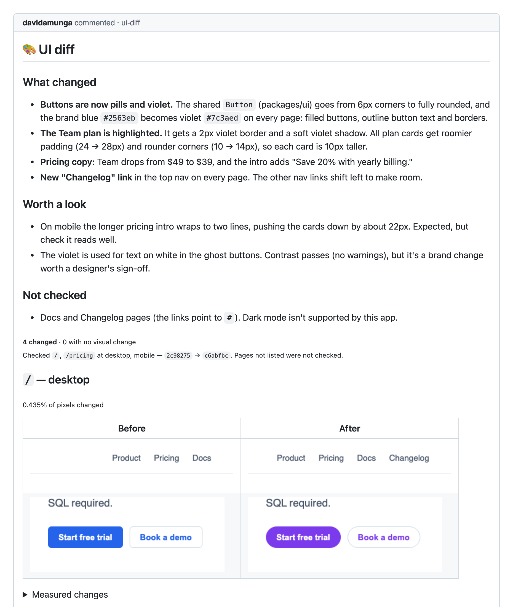

# ui-diff

[](https://github.com/davidamunga/ui-diff/actions/workflows/test.yml)

An agent skill that shows reviewers what a pull request **looks like**, not just what
its code is.



Run it on a branch and your agent will:

1. Work out which pages the PR affects from the changed files (routes, layouts, shared components, CSS/tokens).
2. Run the app at the **base** and **head** commits side by side, in git worktrees on free ports. Your checkout and your other running servers are untouched.
3. Screenshot each affected page on desktop and an emulated iPhone (dark mode optional), with animations frozen so the shots are reproducible.
4. Pixel-diff them and crop zoomed before/after images of each changed region.
5. **Measure** the change: compare every element's computed styles to get exact values ("padding 8×14 → 12×20px", "`#2563EB` → `#9CA3AF`"), spot layout shifts and copy changes, and flag new WCAG contrast failures.
6. Write a short design summary from those measurements and the images, leading with what looks unintended.
7. Write a local review page (`.ui-diff/report/index.html`) with a before/after slider, side-by-side and diff overlay views.
8. Optionally, compare the result with the **Figma** frame you link, side by side with the differing areas boxed ([`figma.md`](skills/ui-diff/references/figma.md)).
9. Post it to the PR as a comment, or as a section of the PR description. Re-runs update the same comment instead of adding new ones.

## Install

`ui-diff` is an [Agent Skill](https://agentskills.io): a `SKILL.md` folder plus scripts. Any
agent that supports the format can use it, including Claude Code, Codex, Cursor, Gemini CLI,
GitHub Copilot, OpenCode, Goose, Windsurf, Amp, Cline, Roo Code and Kiro.

**Claude Code** (as a plugin):
```
/plugin marketplace add davidamunga/ui-diff
/plugin install ui-diff@ui-diff
```

**Every agent on your machine**, with the installer in this repo:
```bash
git clone https://github.com/davidamunga/ui-diff.git && cd ui-diff
./install.sh                    # links the skill into each detected agent's skills folder
./install.sh --list             # show agents, paths, and what's installed
./install.sh --agents codex,cursor
./install.sh --project ~/Work/my-app   # one project only: my-app/.agents/skills/
./install.sh --uninstall
```
Symlinks are the default, so `git pull` updates every agent at once. Pass `--copy` if you'd
rather have copies.

**Or with the [`skills`](https://skills.sh) CLI** (Node 22.20+):
```bash
npx skills add davidamunga/ui-diff            # project-level, asks which agents
npx skills add davidamunga/ui-diff -g -a codex -a cursor -a gemini-cli -a github-copilot
```

**Manually:** copy or symlink `skills/ui-diff/` into the agent's skills folder:

| Agent | User-level | Project-level |
|---|---|---|
| Claude Code | `~/.claude/skills/` | `.claude/skills/` |
| Codex, Cline | `~/.agents/skills/` | `.agents/skills/` |
| Cursor | `~/.cursor/skills/` | `.agents/skills/` |
| Gemini CLI | `~/.gemini/skills/` | `.agents/skills/` |
| GitHub Copilot | `~/.copilot/skills/` | `.agents/skills/` |
| OpenCode | `~/.config/opencode/skills/` | `.agents/skills/` |
| Goose | `~/.config/goose/skills/` | `.goose/skills/` |
| Windsurf | `~/.codeium/windsurf/skills/` | `.windsurf/skills/` |
| Amp | `~/.config/agents/skills/` | `.agents/skills/` |

The repo is public: anyone can clone it or install it with any of the methods above.

Requirements: bash, git, Node 18+, and `gh` (logged in) for posting to PRs. On the first run
Playwright and Chromium are installed into `~/.cache/ui-diff`. Your project's dependencies
are not changed.

## Use

Just ask:

> add before/after screenshots of my UI changes to the PR

> did my tailwind config change break any pages? check desktop and mobile

> ui diff for PR #482, put it in the description

> does /pricing match the design? https://www.figma.com/design/AbC123/App?node-id=12-34

For Figma comparisons the agent uses its Figma tool (e.g. the Figma MCP server) if it has
one, otherwise the Figma REST API with a `FIGMA_TOKEN` personal access token.

To save the routes, dev command, masks for dynamic content, and login state for future
runs, add a `.ui-diff.json` file. See [`skills/ui-diff/references/config.md`](skills/ui-diff/references/config.md).

## Run in CI

The same pipeline runs as a GitHub Action, with no agent, on every push to a PR. Copy
[`examples/workflows/ui-diff.yml`](examples/workflows/ui-diff.yml) into `.github/workflows/`:

```yaml
on:
  pull_request:
    types: [opened, synchronize, reopened]
permissions:
  contents: write        # push screenshots to the ui-diff-assets branch
  pull-requests: write   # add / update the PR comment
jobs:
  ui-diff:
    runs-on: ubuntu-latest
    steps:
      - uses: actions/checkout@v4
        with:
          ref: ${{ github.event.pull_request.head.sha }}
          fetch-depth: 0
      - run: npm ci          # your project's install step
      - uses: davidamunga/ui-diff@v0
        with:
          routes: /,/pricing
```

What's different from running it through an agent:

- **Routes must be given**, in `routes` or in `.ui-diff.json`. Nothing works them out from the
  diff, and the action fails with a message if neither lists any.
- **The summary is automatic.** It's built from the measured changes (styles, copy, added
  elements, layout shifts, new contrast failures, page errors) and labelled as automatic.
  To use your own, write a Markdown file in an earlier step and pass it as `summary`.
- **You install the dependencies.** Run your own install step (`npm ci`, `pnpm install`, …)
  before the action. Head reuses them. Base reuses them too when the lockfile is the same,
  and runs the install in its own worktree otherwise (`install` in `.ui-diff.json` overrides it).
- **Permissions:** the job needs `contents: write` for the assets branch and
  `pull-requests: write` for the comment.
- **Fork PRs and Dependabot PRs are skipped**, with a log line, because GitHub gives them a
  read-only token. Don't work around this with `pull_request_target`: that would run the
  PR's code with a write token.

Playwright and Chromium are cached between runs, keyed on `setup.sh`. Missing system
libraries for Chromium are installed on Linux runners if needed.

| Input | Default | |
|---|---|---|
| `routes` | | Comma-separated, e.g. `/,/pricing`. Added to `.ui-diff.json`'s routes. |
| `dev-command` | detected | Starts the app; `{port}` is replaced with the port. |
| `viewports` | `desktop:1440x900,mobile:iPhone 13` | |
| `color-schemes` | `light` | e.g. `light,dark` |
| `mode` | `comment` | `comment`, `description` (a section of the PR description), or `prune` |
| `working-directory` | `.` | Where the repo is checked out, if you used `path:` with checkout. |
| `base` | the PR's base commit | |
| `config` | `.ui-diff.json` | |
| `summary` | automatic | Markdown file to use as the summary. |
| `assets-branch` | `ui-diff-assets` | |
| `server-timeout` | `180` | Seconds to wait for each dev server. |
| `github-token` | `github.token` | |

Outputs: `changed`, `added`, `removed`, `unchanged`, `errors`, `comment-url`, `report-dir`,
and `skipped` (`true` for fork/Dependabot PRs). The example workflow also uploads
`.ui-diff/report` and the server logs as a build artifact.

**Cleaning up.** [`examples/workflows/ui-diff-cleanup.yml`](examples/workflows/ui-diff-cleanup.yml)
runs the action with `mode: prune` when a PR is closed, removing that PR's images from the
assets branch (its comment then shows broken images). Any `closed` event does the same, so
you can also add `closed` to the main workflow's `types`. Locally, or from an agent:
`bash skills/ui-diff/scripts/prune.sh <pr-number>`.

## Where the images go

GitHub has no public API for the drag-and-drop `user-attachments` uploads, so by default
the images are pushed to a `ui-diff-assets` branch in the same repo and embedded
from there. They render inline, and in private repos they're visible to anyone with read access.
The branch is kept as a single commit, so it doesn't bloat clones. `scripts/prune.sh <pr>`
(or the [cleanup workflow](#run-in-ci)) removes one PR's images, `UI_DIFF_PRUNE=1` drops
images of all closed PRs on the next publish, and you can delete the branch at any time. If you can't push to the repo
(e.g. a PR from a fork), it falls back to manual mode. If you'd rather not have that branch, ask for **manual** mode: the agent
writes the comment and opens the image folder, and you drag the images into GitHub yourself.

## Development

```bash
tests/selftest.sh          # ~30s: unit checks + full pipeline on a static fixture site (no network)
tests/selftest.sh --full   # ~45s more: also scaffolds and diffs a real Vite + React app
tests/selftest.sh --keep   # keep the temp repos for inspection
```

The fast tier builds throwaway git repos from `tests/fixtures/static-site/` (`head/` is
overlaid on `base/`) and checks everything the skill promises: measured style, copy and
contrast changes, new vs unchanged pages, zero false positives on a non-visual change,
uncommitted-change labelling, publishing to and pruning a local bare remote, the automatic
summary, the GitHub Action's script (`action/ci.sh`, with a fake PR event and a stub `gh`), failure reporting, and
that servers, worktrees and unrelated processes are cleaned up or left alone. Nothing
touches GitHub. Run it after any change to `skills/ui-diff/scripts/`.

## Layout

```
LICENSE                         MIT
install.sh                      install for every detected agent
action.yml                      GitHub Action (runs action/ci.sh)
action/ci.sh                    the pipeline with no agent: run → publish → comment → post, or prune
examples/workflows/             workflows to copy: ui-diff.yml, ui-diff-cleanup.yml
skills/ui-diff/
├── SKILL.md                    the workflow the agent follows
├── LICENSE.txt                 MIT (copy that travels with the skill folder)
├── scripts/
│   ├── run.sh                  the whole pipeline: worktrees → servers → capture → diffs
│   ├── setup.sh                one-time toolchain install
│   ├── devcmd.cjs              detect the dev-server command and port flag
│   ├── linkdeps.cjs            reuse installed deps in a worktree without sharing build caches
│   ├── capture.cjs             deterministic screenshots + computed-style snapshots
│   ├── diff.cjs                pixel diff, changed regions, zoom crops
│   ├── stylediff.cjs           measured style/layout/copy/contrast changes
│   ├── figma-export.cjs        export a Figma frame as PNG (REST API, FIGMA_TOKEN)
│   ├── compare.cjs             design vs implementation: composite, regions, zooms
│   ├── viewer.cjs              local before/after review page (index.html)
│   ├── publish.sh              push images to the assets branch
│   ├── prune.sh                remove a closed PR's images from it
│   ├── assets.sh               shared by both: throwaway clone, single-commit push
│   ├── comment.cjs             render the PR markdown
│   └── post.cjs                create or update the PR comment / description section
└── references/
    ├── route-mapping.md        changed files → routes, per framework
    ├── config.md               .ui-diff.json options, auth, noise control
    └── figma.md                comparing with a Figma design
tests/
├── selftest.sh                 end-to-end self-test
├── check-spec.cjs              Agent Skills spec compliance check
├── expect.cjs                  assertion helper
└── fixtures/static-site/       base/ + head/ overlay for the demo site
```

## License

MIT. See [LICENSE](LICENSE).
